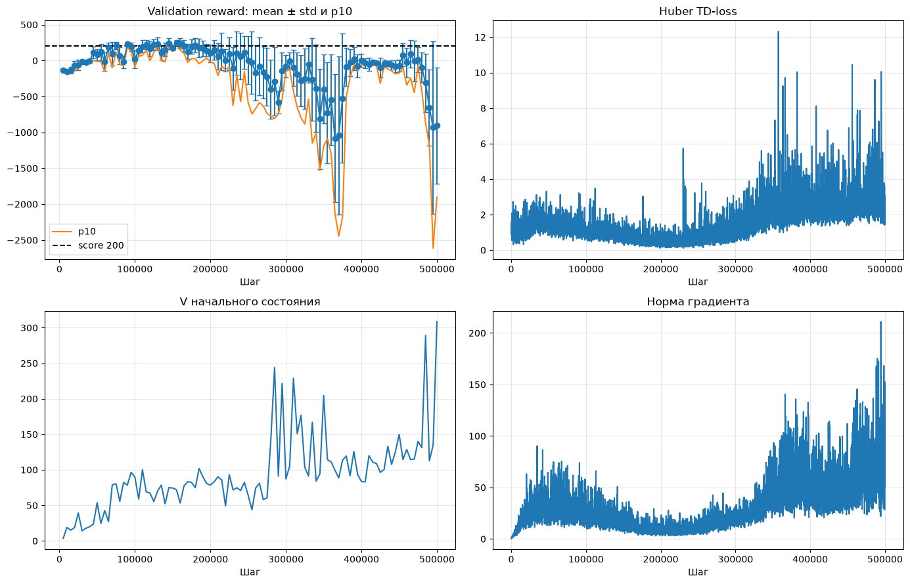
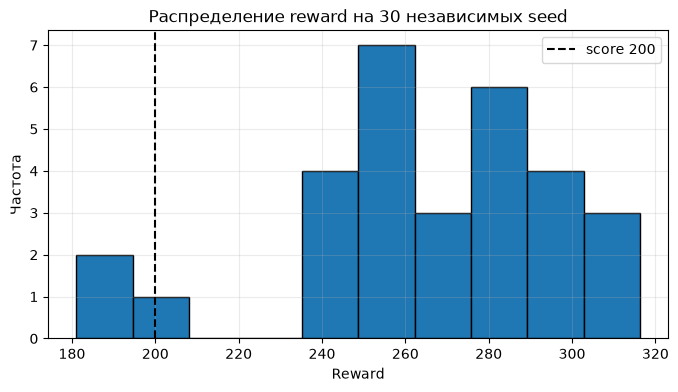
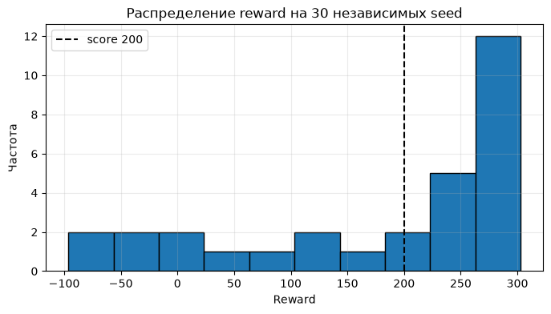
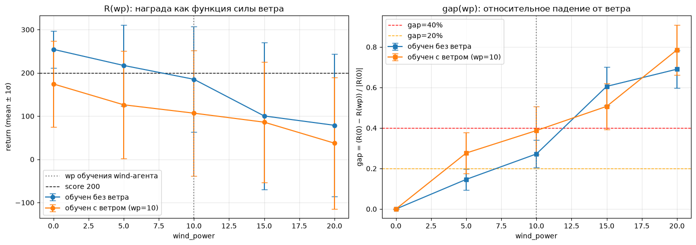

Среда в которой получены результаты:

**Python 3.13.13 (main, Apr  7 2026, 20:48:32)**

**VSC [MSC v.1944 64 bit (AMD64)]**

Зависимости необходимые для запуска содержатся в файле репозитория

**requrements.txt**


## Как запустить
1. Клонирвоать репозиторий: `git clone https://github.com/Andrey-EE-ML-ICS/RL_TRACK_SW`
1. Установить зависимости: `pip install -r requirements.txt`
2. Запустить ноутбук сверху вниз (`Run All`).
3. Время выполнения на CPU: ~30–40 мин (обучение двух агентов по 500k шагов + оценка).
4. Для записи видео нужен `ffmpeg` (или `pip install imageio-ffmpeg`).


# Для сессионного задания был выбран Трек1. Агент в классической среде

### 1. Исследовательский вопрос.*

Среда gymnasium Lunalander-V3. При фиксированном бюджете взаимодействий: зависит ли величина падения качества агента при оценке в условии с ветром(шумом) не встречавшемся при обучении, от того, подвергался ли агент ветру во время обучения? То есть, покажет ли агент, обученный с ветром(enable_wind=True), меньший разрыв при оценке с ветром, чем агент, обученные без ветра.

### 2. Гипотеза
Базовое условие (обучение без ветра): при оценке с ветром средняя награда падает более чем на 40% относительно оценки без ветра. Экспериментальное условие (обучение с ветром, тот же бюджет): при той же оценке с ветром падение менее 20%.
Причина: обучение с ветром вынуждает политику выучить компенсаторные управляющие действия и стать устойчивой к возмущениям динамики. Политика, обученная без ветра, опирается на точную детерминированную динамику, и боковая сила ветра напрямую ломает отслеживание траектории.
Рискованность: при слишком слабом ветре различие может быть незначимым, при слишком сильно оба агента рушатся, и разница скрывается. Нужен предварительный подбор wind_power, при котором базовое условие заметно деградирует, а экспериментальное ещё обучаемо.
### 3. Метрика
Основная: относительный разрыв gap=(R_calm-R_wind)/|R_calm|, где R_calm – средняя награда при оценке с enable_wind=False (100 эпизодов), R_wind – при enable_wind=True с измененым wind_power от 0 до 20 шаг 5 wind_power (100 эпизодов, на каждую силу ветроу).

**Обучение агента без ветра**



**Распределение наград Агента без ветра на 30 независимых seed**



**Обучение агента c ветром**


**Распределение наград Агента без ветра на 30 независимых seed**




*Финальное качество в среде без ветра*

|Агент|	mean|	std|	median	|p10|	min|	max|	доля ≥ 200|
|---|---|---|---|---|---|---|---|
|Без ветра|	264.1	|32.4	|269.4|	232.2|	181.1|	316.3|	93.3%|
|С ветром (wp=10)|	174.7|	125.1|	250.7|	−19.4| −96.2 |	302.8	|60.0%|

# Вывод по экспериментальному исследованию

1. Цель и постановка

Исследовательский вопрос. При фиксированном бюджете взаимодействий (500 000 шагов) зависит ли величина падения качества RL-агента при оценке в условиях ветра (не встречавшегося при обучении) от того, подвергался ли агент ветру во время обучения?

Гипотеза. Базовое условие (обучение без ветра) при оценке с ветром падает более чем на 40% относительно оценки без ветра. Экспериментальное условие (обучение с ветром при wp=10, тот же бюджет и гиперпараметры) при той же оценке падает менее чем на 20%. Причина: обучение с ветром вынуждает политику выучить компенсаторные действия и стать устойчивой к возмущениям динамики; политика без ветра опирается на детерминированную динамику, и боковая сила ломает отслеживание траектории.

Метрика. gap(wp) = (R_calm − R_wind(wp)) / |R_calm|, где R_calm — средняя награда при enable_wind=False (50 эпизодов), R_wind(wp) — средняя награда при enable_wind=True, wind_power ∈ {0, 5, 10, 15, 20} (по 50 эпизодов на каждую силу).

План сравнения. Меняется ровно один фактор — наличие ветра при обучении. Алгоритм (Dueling DQN), бюджет (500k), seed (42), процедура оценки и гиперпараметры (lr=1e-3, decay=60k, batch=256, Huber, Double DQN, hard target update каждые 1000 шагов) идентичны у обоих агентов.


**График награда как функция от силы ветра. Каждая точка собиралась на 50 эпизодах при разной силе ветра**




Относительное падение gap
```
Cила ветра 5
База:  R_calm=254.3, R_wind=217.1, gap=14.6%
Ветер: R_calm=174.3, R_wind=126.1, gap=27.6%
Гипотеза: НЕ ПОДТВЕРЖДЕНА
Cила ветра 10
База:  R_calm=254.3, R_wind=185.1, gap=27.2%
Ветер: R_calm=174.3, R_wind=106.8, gap=38.7%
Гипотеза: НЕ ПОДТВЕРЖДЕНА
Cила ветра 15
База:  R_calm=254.3, R_wind=100.3, gap=60.5%
Ветер: R_calm=174.3, R_wind=86.0, gap=50.7%
Гипотеза: НЕ ПОДТВЕРЖДЕНА
Cила ветра 20
База:  R_calm=254.3, R_wind=78.8, gap=69.0%
Ветер: R_calm=174.3, R_wind=37.4, gap=78.5%
Гипотеза: НЕ ПОДТВЕРЖДЕНА
```

**3. Проверка гипотезы**

Критерий гипотезы: gap_base > 40% и gap_wind < 20% при wp = 10 (тот же ветер, что при обучении wind-агента).

Фактические значения:

gap_base(10) = 27.2% — не превышает 40%;

gap_wind(10) = 38.7% — превышает 20%.

Гипотеза в исходной формулировке не подтверждена. Более того, направление эффекта обратное ожидаемому: wind-агент падает сильнее базового (38.7% против 27.2%), а не слабее.


### Заключение
При фиксированном бюджете 500 000 шагов и выбранных гиперпараметрах гипотеза о повышенной устойчивости агента, обученного с ветром, не подтверждена: gap_base(10) = 27.2% (< 40%) и gap_wind(10) = 38.7% (> 20%). Основная причина — несостоятельность wind-агента: он не сходится даже в спокойной среде (R_calm = 174 < 200), и его больший gap отражает общую слабость политики, а не отсутствие компенсаторных навыков. Направление эффекта при более сильном ветре (wp=15: 50.7% у wind-агента против 60.5% у базового) не противоречит идее о компенсаторных навыках, но этот результат получен при оценке в ветре, более сильном, чем при обучении, и требует отдельной симметричной проверки.

Полученный результат — валидный отрицательный результат, указывающий на границу применимости выбранных гиперпараметров: при wp=10 и бюджете 500k экспериментальное условие выходит за пределы обучаемости. Для корректной проверки гипотезы необходимо либо снизить wp до 5, либо симметрично стабилизировать обучение обоих агентов (soft target, меньший lr, больший decay), либо переформулировать критерий в терминах направления (gap_wind < gap_base при том же wp), а не абсолютных порогов 40%/20%.


